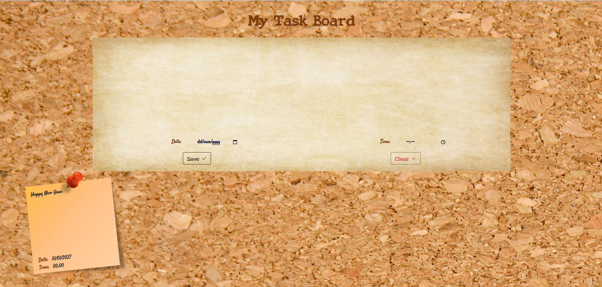

# Task Board

A simple task management application featuring a virtual corkboard with sticky notes.

## Overview

Task Board is a personal project originally developed in 2021.

The application provides a visual interface for creating and organizing tasks as sticky notes on a virtual corkboard.

## Features

- Corkboard-style task management interface
- Sticky notes for displaying tasks
- Date and time selection
- Save and clear controls

## Screenshot



## Project Structure

```text
task-board/
├── docs/
│   └── screenshots/
│       └── screenshot.png
├── src/
├── .editorconfig
├── LICENSE
└── README.md
```

## Installation

Clone the repository:

```bash
git clone https://github.com/StasX/task-board.git
cd task-board
```

## Project Status

**Historical project (2021)**

This repository is preserved as part of my software development portfolio.

## License

This project is licensed under the BSD 3-Clause License. See [LICENSE](LICENSE) for details.

## Author

**Stanislav Mestechkin**

GitHub: [@StasX](https://github.com/StasX)